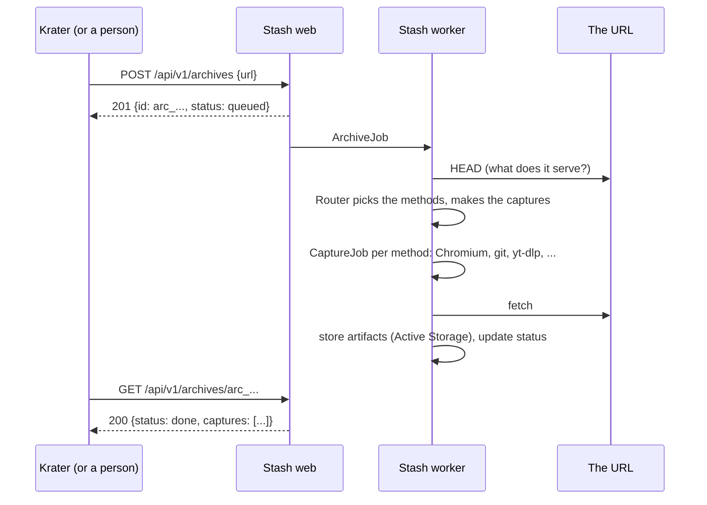

# Stash

Stash is the Patchwork Labs archive. It takes a URL and keeps a durable copy of what was there: web pages, GitHub and other git repositories, presentations and documents, videos and photo posts. Patch apps call it when a member submits a project, so a reviewer can see what was submitted even after the member changes or deletes it. People with the `archivist` role can also archive a URL by hand.

- Design: [docs/design.md](docs/design.md)
- API for patch apps: [docs/api.md](docs/api.md)
- Deploy contract: [docs/deploy.md](docs/deploy.md)

## Stack

Rails 8.1 on Ruby 4.0, server-rendered ERB with Tailwind, GoodJob for the captures, Active Storage for the files, Weave for sign-in. The capture tools are headless Chromium (through Ferrum), git, the GitHub API, yt-dlp, gallery-dl and LibreOffice.

## How an archive happens



## Development

Needs Ruby 4.0 (`.ruby-version`), Bun, Docker (for Postgres), git, and for the capturers you want to try: Chrome or Chromium, yt-dlp, gallery-dl, LibreOffice.

```sh
cp .env.example .env            # STASH_AUTH_MODE=dev is set; add BROWSER_PATH for the page capturer
docker compose up -d            # Postgres on localhost:5436
bin/setup --skip-server         # gems, bun, database
bin/dev                         # server on :3000, Tailwind, GoodJob
```

On a Mac, point Ferrum at Chrome in `.env`:

```sh
BROWSER_PATH="/Applications/Google Chrome.app/Contents/MacOS/Google Chrome"
```

Open <http://localhost:3000>, pick the dev sign-in, sign in as Archie Archivist, and archive a URL.

The first time, the `stash` schema does not exist in the local database. `bin/setup` runs `db:prepare`, which loads `db/central_schema.rb`; its first line creates the schema.

## Checks

```sh
bin/rails test
bin/rubocop
npx @herb-tools/linter && npx @herb-tools/formatter --check
bin/brakeman --no-pager && bin/bundler-audit
docker build -t stash .         # the production image (docs/deploy.md)
```

Tests never call the network. `FakeWeave` in `test/support` stubs Weave; `FakeCapturer` stands in for the capturers.

## Sign-in and roles

Weave OIDC. The roles come from the `roles` claim:

| Role | Can |
|---|---|
| `viewer` | open archives, download artifacts |
| `archivist` | also archive a URL by hand, and run an archive again |
| `admin` | also delete an archive (with a reason), and open the jobs dashboard at `/admin/jobs` |

Patch apps use the API with a Weave `client_credentials` token with the scope `stash`.

## Data

Stash uses `patchwork-central`, schema `stash`. Models inherit `CentralRecord`. Migrations go in `db/central_migrate`. Stash stores a requester's Weave `sub` only, never a name or email.

Every record has a public id: `arc_` archives, `cap_` captures, `art_` artifacts, `aud_` audit events. Routes hold the encoded id without the prefix; the pages and the API show the full id. Nothing exposes a database id.
