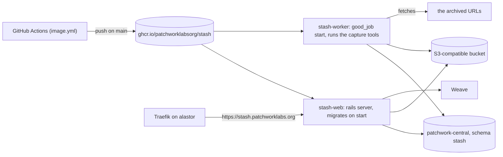

# Deploy

Stash runs on a lab host as Docker containers, like Quilt on batting. A NixOS module in the infra repo starts them. This page is the contract between this repo and that module. The module itself is not in this repo.

## The image

- `Dockerfile` builds a multi-stage image on `ruby:4.0.9-slim`. The final image carries the capture tools: Chromium, git, ffmpeg, yt-dlp, gallery-dl and LibreOffice. It runs as the non-root user `rails` (uid 1000).
- The build runs `bootsnap precompile` and `assets:precompile` with `SECRET_KEY_BASE_DUMMY=1`, so the build needs no secrets.
- `.github/workflows/image.yml` builds `linux/amd64`. A pull request only builds. A push to `main` pushes `ghcr.io/patchworklabsorg/stash:<sha>` and `:main`.

## Commands

| Process | Command | Notes |
|---|---|---|
| web | `./bin/rails server -b 0.0.0.0 -p 3000` (the default `CMD`) | Listens on port 3000. Health check: `GET /up` answers 200 |
| worker | `bundle exec good_job start` (the same as `bin/jobs`) | Runs the captures. Two at a time (`GOOD_JOB_MAX_THREADS=2`). In production, the web process runs no jobs |

`bin/docker-entrypoint` runs `./bin/rails db:migrate` before the web server starts. It does not migrate for any other command, so the worker never migrates. Start the worker after the web container, or let systemd restart it until the schema is there.

## Environment

| Variable | Production | Staging |
|---|---|---|
| `RAILS_ENV` | `production` | `staging` (the construction border on every page) |
| `SECRET_KEY_BASE` | a long random string | the same, its own |
| `CENTRAL_DATABASE_URL` | `postgres://stash:<password>@skein.wildebeest-stargazer.ts.net:5432/patchwork_central` | the staging cluster on hem:5432 |
| `STASH_HOSTS` | `stash.patchworklabs.org` | `stash-staging.patchworklabs.org` |
| `WEAVE_ISSUER`, `WEAVE_CLIENT_ID`, `WEAVE_CLIENT_SECRET` | the Stash app in Weave, redirect URI `https://stash.patchworklabs.org/auth/callback` | the Stash app in Weave staging |
| `STASH_STORAGE_SERVICE` | `disk` (the infra module sets it) or `s3` | the same |
| `STASH_STORAGE_PATH` | with `disk`: the host directory bind-mounted into both containers, `/data/stash` | `/data/stash-staging` |
| `S3_ENDPOINT`, `S3_BUCKET`, `S3_REGION`, `S3_ACCESS_KEY_ID`, `S3_SECRET_ACCESS_KEY` | with `s3`: the bucket | its own bucket |
| `GITHUB_TOKEN` | optional, read-only public access | optional |
| `CAPTURE_TIMEOUT`, `CAPTURE_MAX_BYTES` | defaults 600 seconds, 2 GB | the same |
| `GOOD_JOB_MAX_THREADS` | `2` | `1` |

The worker needs `/tmp` with room for a capture (a video or a repository), and `/dev/shm` of at least 1 GB or Chromium with `--disable-dev-shm-usage` (already set). Give the worker container 2 GB of memory.

## What the infra module must provide

1. **The database role and schema.** A login role `stash` in `patchwork-central`, and a schema `stash` that the role owns (hosts/central-db-schema.nix).
2. **The files.** Either a host directory for the `disk` service, bind-mounted into both containers at the same path and owned by uid 1000 (the `rails` user in the image), with a backup; or an S3-compatible bucket and a key pair with read and write on it. The first deploy (hank, `modules/stash` in infra) uses the directory.
3. **The Weave app.** An OAuth application in Weave with the redirect URI, the scopes `openid profile email roles` for sign-in, and `introspect` so that Stash can check patch apps' tokens. App roles `viewer`, `archivist`, `admin`.
4. **A Traefik router on alastor** for the hostname, to the host's nginx on the tailnet, as for Quilt and Krater.
5. **The env file** as an agenix secret, with the variables above.

## Patch apps

A patch app that calls the API needs a Weave `client_credentials` token with the scope `stash`. Allow that scope on the patch app in Weave. See [api.md](api.md).
