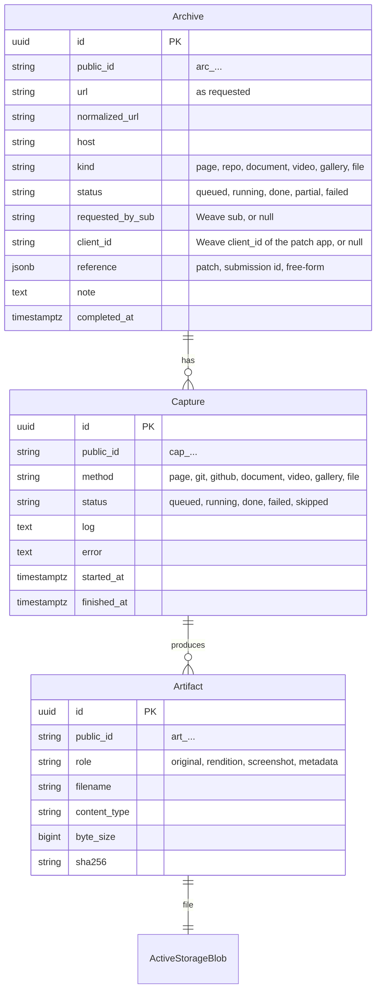

# Design

Stash is the Patchwork Labs archive. It takes a URL and keeps a durable copy of what was at that URL: web pages, GitHub and other git repositories, presentations and documents, videos and photo posts. Patch apps call it when a member submits a project, so a reviewer can see what was submitted even after the member changes or deletes it. People can also archive a URL by hand.

Stash is general purpose. It is not tied to one patch or one kind of submission. The same archive model serves a repository, a Google Slides deck, a YouTube video and a plain web page.

## Why not arker

Hack Club runs [arker](https://github.com/hackclub/arker) for the same job. Jasper and Adam decided on 2026-11-08 to build Stash instead, so that it covers documents and presentations as well as pages, repos and videos, and so that it follows the Patchwork conventions: Weave sign-in, public ids, the central Postgres, the staging border and a NixOS module in `infra`.

## Model



- **Archive**: one request to archive one URL. It is the unit that a patch app references and that a reviewer opens.
- **Capture**: one method run against the URL. `Capturers::Router` picks the methods from the URL. A capture that does not apply is `skipped`, never deleted, so the record shows what was tried.
- **Artifact**: one stored file from a capture, in Active Storage. A document capture has an `original` (the `.pptx`) and a `rendition` (the PDF). A git capture has an `original` (the bundle) and `metadata` (the ref list).

Primary keys are UUIDs. Every record has a public id from `encoded_ids` (`arc_`, `cap_`, `art_`; registered in internal-docs). URLs, the API and the pages use the public id only. Timestamps are UTC.

An archive's status comes from its captures: `done` when every capture that applies is done, `partial` when at least one is done and one failed, `failed` when none is done.

## Capturers

Each capturer is one class in `app/services/capturers/`, with one public method `call(capture, workdir)`. It writes files into `workdir` and returns the artifacts to store. `CaptureJob` makes the workdir, runs the capturer under a timeout, stores the artifacts, and deletes the workdir.

| Method | Tool | Applies to | Artifacts |
|---|---|---|---|
| `page` | headless Chromium (Ferrum), one load | every `http(s)` URL that serves HTML | `original`: MHTML of the rendered page, `screenshot`: full-page PNG, `rendition`: print PDF |
| `git` | `git clone --mirror`, `git bundle` | GitHub, GitLab, Codeberg, Bitbucket, sr.ht, any `.git` URL | `original`: `.bundle`, `metadata`: refs and HEAD |
| `github` | GitHub REST API | `github.com/<owner>/<repo>` | `metadata`: repo JSON, releases, last 100 commits, contributors; README as served |
| `document` | HTTP download, Google export URLs, LibreOffice | Google Docs, Slides, Sheets, Drawings; direct `.pdf`, `.pptx`, `.docx`, `.xlsx`, `.odp`, `.odt`, `.key` and others | `original`: the file as served; `rendition`: PDF |
| `video` | `yt-dlp` | YouTube, Vimeo, TikTok, Loom, Twitch, and the other hosts in the router | `original`: media file, `metadata`: info JSON, `screenshot`: poster |
| `gallery` | `gallery-dl` | post URLs on Instagram, X, Reddit, Bluesky, Tumblr, Flickr, Imgur, Pinterest, DeviantArt, ArtStation | `original`: ZIP of the post's media and sidecars, `metadata`: normalized post JSON |
| `file` | HTTP download | a URL whose `Content-Type` is not HTML and that no other method claims | `original`: the bytes as served |

`Capturers::Router.methods_for(url, content_type:)` returns the list of methods for a URL. `ArchiveJob` first asks the server with a `HEAD` request and passes the answer in. The rules, in order:

1. A `github.com/<owner>/<repo>` URL: `github`, `git`, `page`.
2. A URL that ends in `.git`, or a repository on a known git host: `git`, `page`.
3. A Google Docs, Slides, Sheets or Drawings URL: `document`, `page`.
4. A video host: `video`, `page`.
5. A post URL on a gallery host: `gallery`, `page`.
6. A file, by extension or by the `HEAD` content type: `document` when it is an office or PDF type, else `file`.
7. Everything else: `page`.

The router never pulls a whole account: a profile URL on a gallery host is a page, not a gallery. A GitHub owner URL is a page, not a repo.

Each capturer has a timeout (`CAPTURE_TIMEOUT`, default 10 minutes) and a size limit (`CAPTURE_MAX_BYTES`, default 2 GB). A capture past either limit fails with that reason in `error`. Nothing is deleted on failure: the other captures of the archive still run.

Every external tool runs in a subprocess with a clean environment and the URL as an argument, never through a shell string. A capturer never runs code from the archived content.

### Dynamic pages

Many pages draw themselves as the reader scrolls: sections start at opacity 0 and fade in through an IntersectionObserver, images load lazily, animations run for seconds. A capture of the page as first loaded is mostly blank below the fold. So the `page` capturer, before it writes a file:

1. Asks for `prefers-reduced-motion: reduce` and sets the animation playback rate to 50x, both through the DevTools protocol, before the page loads. Pages that honor reduced motion skip their entrance animations. The ones that do not are over in a moment.
2. Waits for the network to go idle (10 seconds at most), then for `document.fonts.ready`.
3. Walks the page one viewport (900px) at a time, a quarter second per step, at most 60 steps, then returns to the top. Observers fire and lazy images load on the way.
4. Waits for the network to go idle again, then one second for the last reveals.

Chromium runs with SwiftShader (`--use-angle=swiftshader`), so WebGL draws in software and a canvas site renders without a GPU; with the GPU off, such a page captured as a blank gradient. A heavy page can take the renderer down once (`Ferrum::DeadBrowserError`); the capturer then tries once more in a new browser. The log notes the elapsed seconds at each step.

Then the MHTML, the full-page PNG and the PDF are written from that state. The MHTML keeps the DOM as revealed, so the archived copy is not blank either. A page that pins sections to the scroll position (a scroll-driven hero) still looks like a long strip in the screenshot. That is the page as it is; the PDF and the MHTML keep the content.

`bin/capture-sample <urls>` runs the capturers on a list of URLs without the database and writes an `index.html` with every screenshot and log, to check a change like this against real pages before it ships.

## Who can do what

Sign-in is Weave OIDC, as in Quilt. The roles come from the `roles` claim:

| Role | Can |
|---|---|
| `viewer` | open archives, download artifacts |
| `archivist` | also archive a URL by hand, and run an archive again |
| `admin` | also delete an archive (with a reason, written to `audit_events`) |

Patch apps use the API with a Weave `client_credentials` token with scope `stash`. `Weave::Introspection` checks it, as Quilt's patch API does. The token's `client_id` is stored on the archive.

Stash stores the requester's Weave `sub` only, never a name or email (the member data rule in internal-docs). Pages fetch display names from Weave's directory on demand.

Nothing in Stash is public. An archived page may hold a member's personal data, and an archive exists for review. A share link for one archive, with an expiry, is a later feature.

## API

```
POST /api/v1/archives
  { "url": "https://...", "reference": { "patch": "ganymede", "submission": "sub_..." }, "note": "..." }
  201 { "id": "arc_...", "status": "queued", "url": "...", "captures": [ { "id": "cap_...", "method": "snapshot", "status": "queued" } ] }

GET  /api/v1/archives/arc_...
  200 { "id", "status", "url", "normalized_url", "kind", "reference", "created_at", "completed_at",
        "captures": [ { "id", "method", "status", "error", "artifacts": [ { "id", "role", "filename", "content_type", "byte_size", "sha256", "download_url" } ] } ] }

GET  /api/v1/archives?url=https://...
  200 { "archives": [ ... ] }   the archives of that normalized URL, newest first
```

`download_url` is a signed Active Storage URL that expires. The API does not accept a callback URL yet. A patch app polls `GET` or shows the Stash link.

Every write to the API is idempotent on `(client_id, reference.submission, normalized_url)` when `reference.submission` is given: a second `POST` with the same three values returns the first archive with `200`. The full contract is in [api.md](api.md).

## Storage

Artifacts live in Active Storage. Development and test use the disk service. Production and staging use an S3-compatible service (`STASH_STORAGE_SERVICE=s3`, with the `S3_*` variables). Direct uploads are off: only the worker writes.

Stash keeps everything. There is no automatic expiry. An admin can delete an archive, and the audit event keeps the URL, the reason, and the sha256 of each artifact.

## Database

Stash uses `patchwork-central` (not the restricted database), schema `stash`. Archives are not confidential in the way that money or identity documents are, but they are internal. Models inherit `CentralRecord`. GoodJob's tables live in the same schema.

## Jobs

`ArchiveJob` makes the capture rows from the router and enqueues one `CaptureJob` per capture. `CaptureJob` runs one capturer, stores its artifacts, and updates the archive's status. The jobs queue is `captures`, with a small concurrency (`GOOD_JOB_MAX_THREADS`, default 2), because Chromium and yt-dlp are heavy.

## Environments

- `development`, `test`: local. Dev sign-in (`STASH_AUTH_MODE=dev`) and the disk service.
- `staging`: deployed at `stash-staging.patchworklabs.org`. Weave staging as IdP, the staging central database on `hem`, its own bucket. The construction border and the STAGING label on every page.
- `production`: deployed at `stash.patchworklabs.org`.

## Later

- Share links with an expiry, for one archive.
- A callback URL on `POST /api/v1/archives`.
- Figma files, itch.io games, Notion pages.
- A WARC export for a whole archive.
- Full text search over snapshots and documents.
